# Домашнее задание к занятию «Запуск приложений в K8S»

Выполнено в MicroK8S (одна нода `student`) с локальным `kubectl`.


## Файлы манифестов

| Файл | Назначение |
|---|---|
| [deployment1.yaml](deployment1.yaml) | Задание 1: Deployment из двух контейнеров — nginx и multitool |
| [service1.yaml](service1.yaml) | Задание 1: Service для доступа к репликам приложения |
| [pod-multitool.yaml](pod-multitool.yaml) | Задание 1: отдельный под с multitool для проверки доступа через `curl` |
| [deployment2.yaml](deployment2.yaml) | Задание 2: Deployment nginx с init-контейнером на busybox |
| [service2.yaml](service2.yaml) | Задание 2: Service, после создания которого стартует основной контейнер |

---

## Задание 1. Deployment и доступ к репликам приложения из другого Pod

### 1. Deployment из двух контейнеров: решение возникшей ошибки

Манифест: [deployment1.yaml](deployment1.yaml).

**Ситуация.** При первом запуске деплоймента контейнеры `nginx` и `multitool` описаны в одном поде, но у контейнера `multitool` порт 80 не переопределён. Контейнеры одного пода находятся в общем сетевом namespace — у них один IP и один набор портов. Образ `wbitt/network-multitool` тоже содержит nginx, который по умолчанию слушает порт 80, поэтому он не может занять порт, уже занятый nginx:

```
nginx: [emerg] bind() to 0.0.0.0:80 failed (98: Address already in use)
```

Контейнер `multitool` перезапускается, под уходит в `CrashLoopBackOff`.

**Исправление ошибки.** В контейнере `multitool` задана переменная `HTTP_PORT=8080` — она меняет порт внутреннего nginx мультитула ([описание образа](https://github.com/wbitt/Network-MultiTool)). Теперь порты в поде различаются: 80 у nginx, 8080 у multitool.

```bash
kubectl apply -f deployment1.yaml
kubectl get pods -o wide -l app=nginx-multitool
kubectl logs -l app=nginx-multitool -c multitool
```

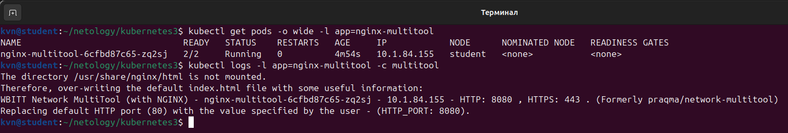

### 2–3. Масштабирование до двух реплик

Количество подов **до** масштабирования (в манифесте `replicas: 1`):

```bash
kubectl get pods
kubectl get deployment nginx-multitool
```

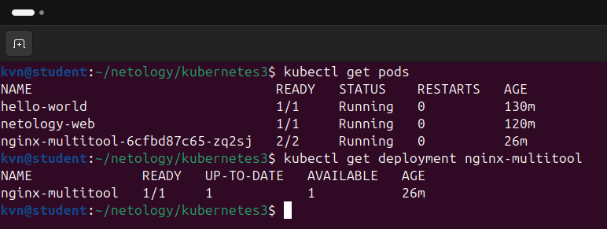

Увеличение количества реплик до двух:

```bash
kubectl scale deployment nginx-multitool --replicas=2
kubectl get pods
```

Количество подов **после** масштабирования:

```bash
kubectl get deployment nginx-multitool
kubectl get pods -o wide
```

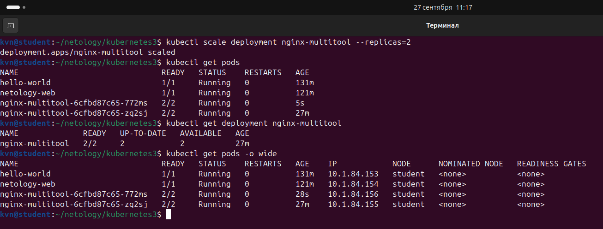

### 4. Service для доступа к репликам

Манифест:  
[service1.yaml](service1.yaml).  
Сервис типа `ClusterIP` открывает два порта: 80 (контейнер `nginx`) и 8080 (контейнер `multitool`). Селектор `app: nginx-multitool` подбирает поды деплоймента, поэтому трафик распределяется по всем репликам.

```bash
kubectl apply -f service1.yaml
kubectl get service nginx-multitool-svc
kubectl get endpointslices -l kubernetes.io/service-name=nginx-multitool-svc -o wide
```

В выводе — адреса обеих реплик.

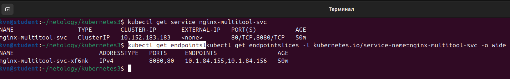

### 5. Доступ к приложению из отдельного пода multitool

Манифест:  
[pod-multitool.yaml](pod-multitool.yaml). 

```bash
kubectl apply -f pod-multitool.yaml
kubectl get pod multitool-pod

# доступ к контейнеру nginx через сервис
kubectl exec multitool-pod -- curl -s -o /dev/null -w 'HTTP %{http_code}\n' http://nginx-multitool-svc

# доступ к контейнеру multitool; в ответе есть имя и IP пода,
# поэтому несколько запросов подряд показывают работу разных реплик
kubectl exec multitool-pod -- sh -c 'for i in 1 2 3 4; do curl -s http://nginx-multitool-svc:8080; done'
```

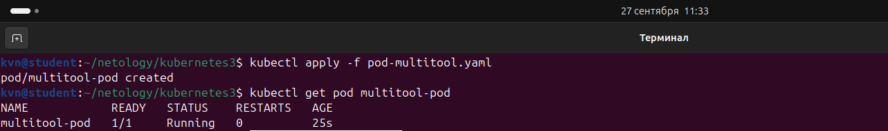

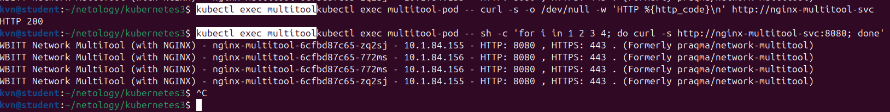

---

## Задание 2. Старт основного контейнера после запуска сервиса

### 1–2. Deployment с init-контейнером

Манифест:  
[deployment2.yaml](deployment2.yaml).  

В поде описан init-контейнер `wait-for-service` на образе `busybox:1.36`, который в цикле проверяет разрешение DNS-имени сервиса:

```sh
until nslookup nginx-svc.default.svc.cluster.local; do
  echo "service nginx-svc is not created yet, waiting..."
  sleep 2
done
```

Пока сервиса нет, имя не разрешается, init-контейнер не завершается, а основной контейнер `nginx` не запускается.

Имя указано полностью: `busybox nslookup` перебирает `search`-домены из `/etc/resolv.conf` и, получив `NXDOMAIN` хотя бы по одному из них, возвращает код 1 даже при найденной записи. С коротким `nginx-svc` условие `until` не завершается никогда.

Проверяется разрешение имени, а не HTTP-доступность: endpoints появляются только у готового пода, а под не станет готовым, пока не завершится init-контейнер. Проверка через `curl` или `wget` дала бы вечное ожидание.

```bash
kubectl apply -f deployment2.yaml
kubectl get pods -l app=nginx-init
kubectl describe pod -l app=nginx-init
kubectl logs -l app=nginx-init -c wait-for-service
```

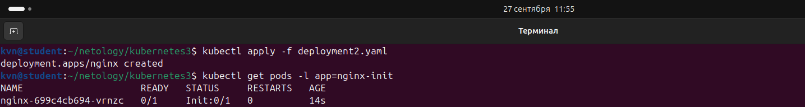

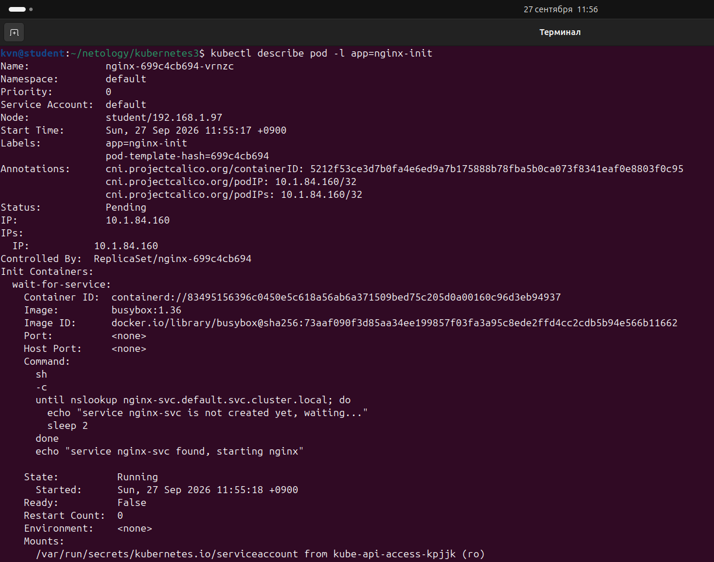

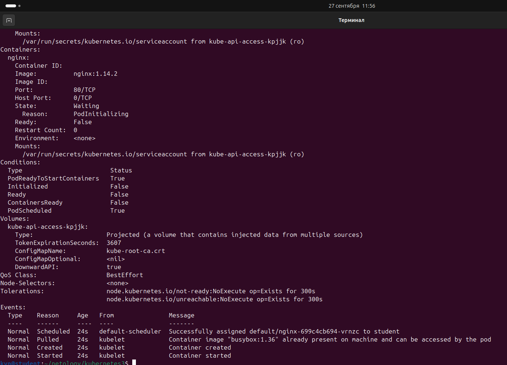

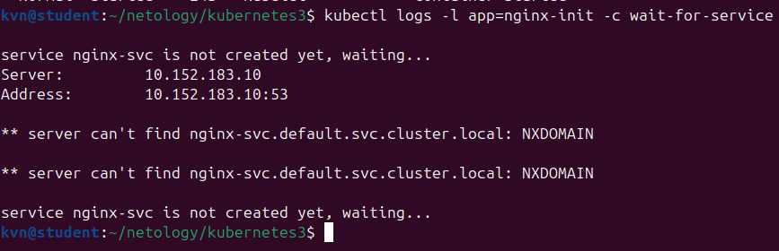

### 3. Создание Service: Init запустился

Манифест:  
[service2.yaml](service2.yaml).  
Применяется вторым, после деплоймента.  

```bash
kubectl apply -f service2.yaml
kubectl get service nginx-svc
kubectl get pods -l app=nginx-init        # init завершён, под переходит в Running
kubectl logs -l app=nginx-init -c wait-for-service
```

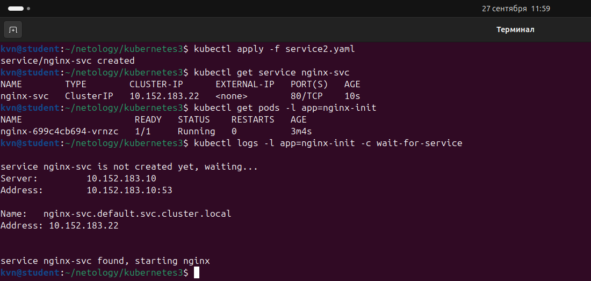


### 4. Состояние пода до и после запуска сервиса

До появления сервиса под висел в `Init:0/1`, а контейнер `nginx` не стартовал. После применения `service2.yaml` init завершился и под перешёл в `Running`:

```bash
kubectl get pods -l app=nginx-init
```

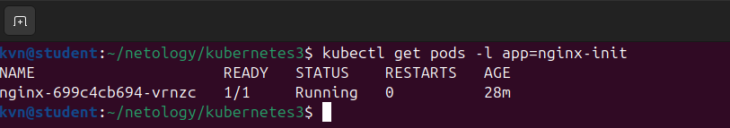

Подробнее состояние пода после старта — в его описании:

```bash
kubectl describe pod -l app=nginx-init
```

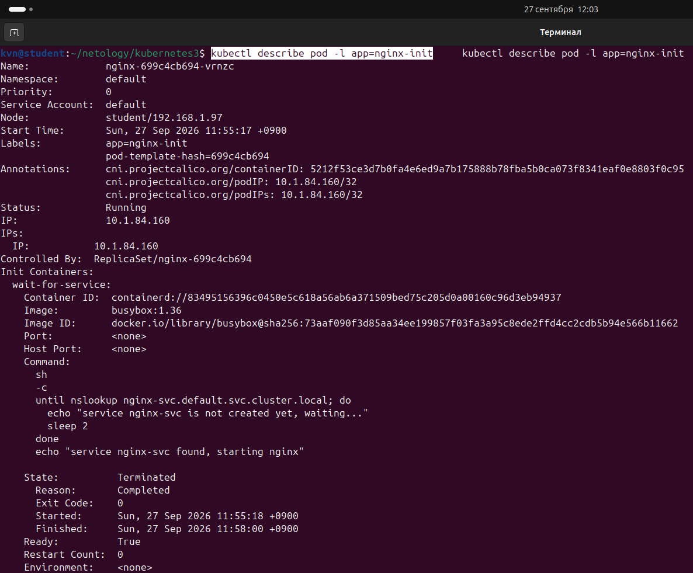

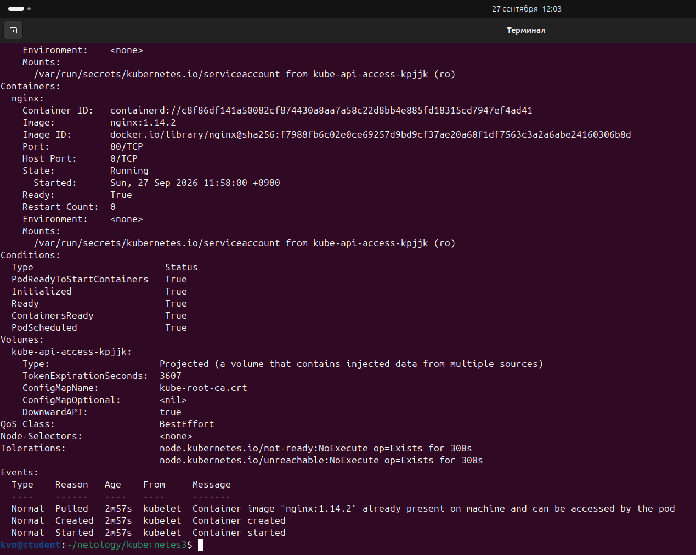

